  

  
  
  

<a href="./README.md">Read in English</a>

---

### ◉ Notas de tapa

**Del píxel a producción.** Soy Juan Saracco, Software Engineer radicado en Buenos Aires. Empecé entregando campañas de email pixel-perfect a millones de usuarios, pasé a ser responsable del frontend de un módulo crítico de un ERP corporativo, y hoy construyo productos completos de punta a punta: desde la interfaz en React hasta la API y el pipeline de CI.

Busco **posiciones de desarrollador Semi-Senior (SSR)**, frontend o full stack. Disponible para trabajo remoto. Ciudadano argentino e italiano (elegibilidad laboral en la UE).

---

### ◉ Lado A — Trabajo

| # | Rol | Sello | Período | Impacto |
|:-:|---|---|:-:|---|
| A1 | **Software Engineer**  React, TypeScript, microfrontends | Hitachi Digital (ex GlobalLogic) · cliente Claro | Jun 2025 – actualidad | Lideré el desarrollo frontend de un nuevo módulo crítico en la reingeniería de un ERP corporativo, con responsabilidad total sobre la interfaz. Migré interfaces legacy a una arquitectura de microfrontends escalable, simulé (mock) los contratos del backend para que el frontend nunca quedara bloqueado y sumé Storybook y tests unitarios. |
| A2 | **HTML Email Developer**  HTML, CSS, scripting | VML · cuenta Microsoft | 2023 – 2025 | Entregué más de 15 emails pixel-perfect por semana con compatibilidad entre clientes de correo, alcanzando a millones de usuarios en todo el mundo. Reduje la tasa de errores en un 20% y acorté el onboarding del equipo de 3 a 2 meses documentando procesos internos. |

### ◉ Lado B — Proyectos

**Destacados**

| | |
|---|---|
| [**TD Autos**](https://github.com/saracco-juan/td-autos) · [demo](https://td-autos.vercel.app) | Proyecto de tesis realizado junto a [Mariano Giardina](https://github.com/marianogiardina). Ayuda a quienes compran autos usados a decidir con seguridad (diagnóstico breve, recomendaciones según perfil, checklists de inspección y transferencia), permite a las concesionarias gestionar su inventario con suscripción mensual y da a los administradores herramientas para incorporar concesionarias y supervisar pagos.  **Stack:** monorepo con API REST en PHP 8.2 + Laravel 12 + Sanctum + Supabase PostgreSQL, SPA web en React 19 + TypeScript + Vite y app móvil en React Native + Expo, con lógica de dominio en TypeScript puro compartida entre web y móvil.  **Demuestra:** entrega de punta a punta, con CI en GitHub Actions, quality gate y cobertura en SonarCloud, Docker, entornos de producción y desarrollo en Vercel desplegados al hacer merge, y documentación técnica. |
| [**J-gym**](https://github.com/saracco-juan/J-gym) · [demo](https://juangym.vercel.app) | PWA mobile-first para registrar entrenamientos de gimnasio en torno a la sobrecarga progresiva.  **Stack:** Next.js 16 (App Router), React 19, TypeScript estricto, Tailwind 4, Supabase (Postgres, auth, Row Level Security), Zustand, Jest.  **Demuestra:** disciplina de arquitectura, con lógica de dominio pura en `src/core`, patrón repositorio en `src/infrastructure` y una UI que nunca accede a Supabase directamente. |

**Otros**

| Proyecto | Qué es | Stack |
|---|---|---|
| [**BuenasLecturas**](https://github.com/saracco-juan/BuenasLecturas) | Biblioteca virtual para seguir tus lecturas y escribir reseñas, con búsqueda de libros vía Open Library. | Spring Boot, BCrypt |
| [**GLYPHA**](https://github.com/saracco-juan/GLYPHA) | App Android para explorar y probar tipografías, con favoritos, perfil y panel de administración. | Java, Firebase |
| [**La Silbatina**](https://github.com/saracco-juan/silbatina) | Muro anónimo de mensajes para hinchas argentinos: cada hincha dispone de 5 "silbidos" para votar y el mensaje más silbado encabeza el tablero. Sin registro; solo se almacena una cookie/IP hasheada (privacidad por diseño), con moderación de administrador. | Node.js, PostgreSQL |

---

### ◉ Equipo

  
   
  
   
  

  
  
  
  
  
  
   
  
  
  

---

### ◉ Cómo trabajo

- **Responsabilidad de punta a punta.** Llevo una funcionalidad desde la interfaz hasta la API y el despliegue, y evito bloqueos simulando contratos de backend en lugar de esperar.
- **Quality gates.** Tests unitarios, Storybook y CI con quality gate y cobertura en SonarCloud, para detectar regresiones antes del merge.
- **Agentes de IA, primero la especificación.** Uso agentes de IA con un flujo guiado por especificaciones y contexto: contexto claro y especificaciones escritas antes del código, para obtener resultados consistentes.

---

  

