  

  
  
  

<a href="./README.es.md">Leer en español</a>

---

### ◉ Liner notes

**From pixel to production.** I'm Juan Saracco, a Software Engineer based in Buenos Aires. I started by shipping pixel-perfect email campaigns to millions of users, moved on to owning the frontend of a critical module in an enterprise ERP, and now build full products end to end, from the React UI to the API and the CI pipeline.

I'm looking for **Semi-Senior (SSR) developer roles**, frontend or full stack. Open to remote work. Argentine and Italian citizen (EU work eligibility).

---

### ◉ Side A — Work

| # | Role | Label | Period | Impact |
|:-:|---|---|:-:|---|
| A1 | **Software Engineer**  React, TypeScript, microfrontends | Hitachi Digital (ex GlobalLogic) · client Claro | Jun 2025 – present | Led the frontend of a new critical module in the re-engineering of a corporate ERP, with full ownership of the UI. Migrated legacy interfaces to a scalable microfrontends architecture, mocked backend contracts so frontend work never blocked on backend, and added Storybook and unit testing. |
| A2 | **HTML Email Developer**  HTML, CSS, scripting | VML · Microsoft account | 2023 – 2025 | Delivered 15+ pixel-perfect emails per week with cross-client compatibility, reaching millions of users globally. Reduced the bug rate by 20% and cut team onboarding from 3 to 2 months by documenting internal processes. |

### ◉ Side B — Projects

**Featured**

| | |
|---|---|
| [**TD Autos**](https://github.com/saracco-juan/td-autos) · [live](https://td-autos.vercel.app) | Thesis project built with [Mariano Giardina](https://github.com/marianogiardina). Helps used-car buyers decide safely (short diagnosis, profile-based recommendations, inspection and transfer checklists), lets dealerships manage inventory under a monthly subscription, and gives admins tools to onboard dealerships and supervise payments.  **Stack:** monorepo with a REST API in PHP 8.2 + Laravel 12 + Sanctum + Supabase PostgreSQL, a web SPA in React 19 + TypeScript + Vite, and a mobile app in React Native + Expo, sharing pure TypeScript domain logic between web and mobile.  **Proves:** end-to-end delivery, with GitHub Actions CI, SonarCloud quality gate and coverage, Docker, production and development environments on Vercel deployed on merge, and technical docs. |
| [**J-gym**](https://github.com/saracco-juan/J-gym) · [live](https://juangym.vercel.app) | Mobile-first PWA to track gym workouts around progressive overload.  **Stack:** Next.js 16 (App Router), React 19, strict TypeScript, Tailwind 4, Supabase (Postgres, auth, Row Level Security), Zustand, Jest.  **Proves:** architecture discipline, with pure domain logic in `src/core`, the repository pattern in `src/infrastructure`, and a UI that never touches Supabase directly. |

**More**

| Project | What it is | Stack |
|---|---|---|
| [**BuenasLecturas**](https://github.com/saracco-juan/BuenasLecturas) | Virtual library to track your reading and write reviews, with book search via Open Library. | Spring Boot, BCrypt |
| [**GLYPHA**](https://github.com/saracco-juan/GLYPHA) | Android app to explore and test typefaces, with favorites, profile and an admin panel. | Java, Firebase |
| [**La Silbatina**](https://github.com/saracco-juan/silbatina) | Anonymous message wall for Argentine football fans: each fan gets 5 "whistles" to vote, and the most whistled message tops the board. No signup, only a hashed cookie/IP is stored (privacy by design), plus admin moderation. | Node.js, PostgreSQL |

---

### ◉ Gear

  
   
  
   
  

  
  
  
  
  
  
   
  
  
  

---

### ◉ How I work

- **End-to-end ownership.** I take a feature from UI to API to deployment, and I unblock myself by mocking backend contracts instead of waiting.
- **Quality gates.** Unit tests, Storybook, and CI with a SonarCloud quality gate and coverage, so regressions are caught before merge.
- **AI agents, spec first.** I use AI agents in a spec-driven, context-first workflow: clear context and written specs before code, for consistent results.

---

  

