  

  
  
  

---

### ◉ Notas de tapa

Desarrollador de software en **Hitachi Digital** y estudiante de **Analista de Sistemas** en la Escuela Da Vinci.

Mi fuerte hoy es el front (**React, TypeScript, microfrontends**), pero me muevo por todo el stack: backend con Node.js, Java y PHP, IoT y apps completas de punta a punta.

Antes armé emails para **Microsoft** desde **VML** (Salesforce Marketing Cloud, AEM y Marketo). Ahí aprendí que el HTML de un email no perdona nada.

**Vivo metido en la IA.** Pruebo cada herramienta nueva que sale (OpenCode, Antigravity, agentes desde la terminal) y la sumo a mi forma de trabajar. La uso con método: contexto claro, specs y prompts bien armados, para que sea un multiplicador real y no una lotería.

---

### ◉ Lado A — Trabajo

| # | Tema | Sello | Año |
|:-:|---|---|:-:|
| A1 | **Front-End Developer**: React, TypeScript, microfrontends | Hitachi Digital (ex GlobalLogic) | `AÑO`–hoy |
| A2 | **Email Developer** para Microsoft: SFMC · AEM · Marketo | VML | `AÑO`–`AÑO` |

### ◉ Lado B — Proyectos

| # | Tema | Notas |
|:-:|---|---|
| B1 | [**BuenasLecturas**](https://github.com/saracco-juan/BuenasLecturas) | Biblioteca virtual para seguir tus lecturas y escribir reseñas. Spring Boot, login con BCrypt y búsqueda de libros vía Open Library. |
| B2 | [**GLYPHA**](https://github.com/saracco-juan/GLYPHA) | App Android para explorar y probar tipografías, con favoritos, perfil y panel de administrador. Java + Firebase. |
| B3 | [**OneUp Gym**](https://github.com/marianogiardina/OneUpGym) | Web de un gimnasio: clases, membresías, calendario e inscripciones, más dashboard de administrador. PHP + Laravel. Hecha junto a [Mariano Giardina Monti](https://github.com/marianogiardina). |
| B4 | [**Dolar-APP**](https://github.com/juan-saracco/Dolar-APP) · [demo](https://dolar-app.netlify.app/) | Conversor de monedas simple y rápido. HTML, CSS y JavaScript. |

---

### ◉ Equipo

  
   
  
   
  

  
  
  
  
  
   
  
  
  
   
  
  
  
  

---

<i>TU VERSO ACÁ: una línea tuya sobre tecnología y existencia.</i>

  

